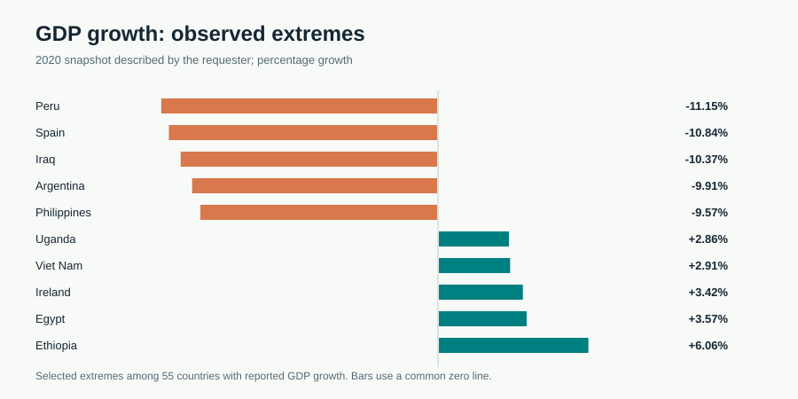
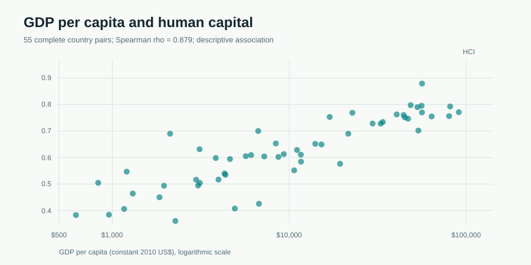
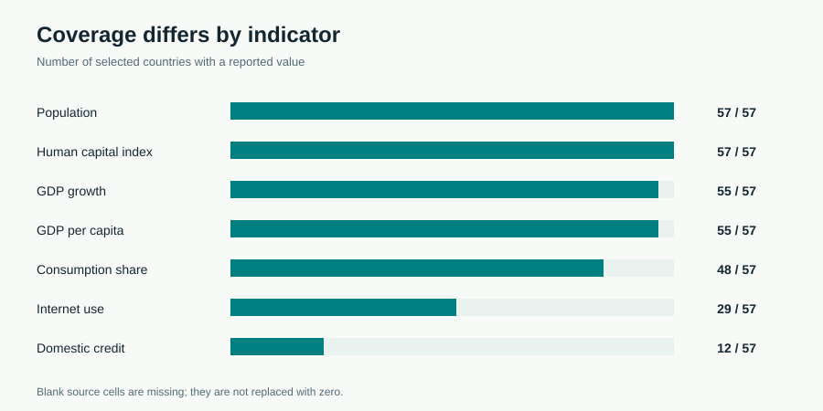

# World Bank 2020 country fact sheet: a cross-sectional assessment

**Research brief | 30 September 2026**  
**Evidence base:** the user-supplied `final_demographics_data.csv`, described as a 2020 World Bank fact sheet. All statistics below were computed directly from that file. The file has no explicit year column, extraction date, indicator codes, or documentation for country selection.

## Executive summary

The supplied dataset covers **57 named countries, 17 source region labels, and 59 numeric indicators**. It is a substantial but selective cross-section: the country populations sum to **6.20 billion**, which is a total for this *sample* and should not be called a world population estimate. China and India alone account for **44.9% of that sample population**.

The central 2020 economic finding is a broad contraction in the included countries. GDP growth is reported for 55 countries; **45 (81.8%) have negative growth** and the **country-level median is -4.02%**. The deepest reported declines are Peru (-11.15%), Spain (-10.84%), Iraq (-10.37%), Argentina (-9.91%), and the Philippines (-9.57%). Ten countries show positive growth, led by Ethiopia (+6.06%) and Egypt (+3.57%). These are comparisons within the supplied selection, not a global ranking.

Development levels differ markedly. Among the 55 countries with GDP per capita reported in constant 2010 US dollars, the country-level median is **$9,322**. The human capital index (HCI) is present for all 57; its median is **0.629**. GDP per capita and HCI have a **Spearman rank correlation of 0.879 (n=55)** in this sample. That association is descriptive and does not establish whether either variable causes the other.

## 1. Coverage and composition

| Measure | Result | Interpretation |
|---|---:|---|
| Countries | 57 | Distinct names, no duplicate rows |
| Numeric indicators | 59 | Excludes country and source Region |
| Numeric values present | 2,692 / 3,363 (80.0%) | Overall cell coverage; varies sharply by indicator |
| Population represented | 6.20 billion | Sum over the selected 57 countries |
| Population-weighted urban share | 56.4% | Sum of urban population divided by sample population |
| GDP growth available | 55 / 57 | Missing for Japan and United Arab Emirates |

This file includes large economies and some small ones but does not explain its sampling method. The 17 geographic labels are uneven: six countries appear in each of South America, South-eastern Asia and Western Europe, while several regions have only one or two. The labels are preserved from the file, including compact forms such as `SouthAmerica`. Aggregates for groups with very few countries can be dominated by country selection.

## 2. Economic outcomes in the supplied 2020 snapshot

The country-level median GDP growth rate is -4.02%. Negative growth appears in 45 of the 55 countries with observations. Because this is a one-year cross-section, the dataset cannot establish a time trend, quantify recovery, or isolate the causes of the 2020 downturn. GDP growth is an annual real output change according to the World Bank indicator definition; it is distinct from the level of GDP or nominal spending.

| Lowest observed GDP growth | % | Highest observed GDP growth | % |
|---|---:|---|---:|
| Peru | -11.15 | Ethiopia | +6.06 |
| Spain | -10.84 | Egypt | +3.57 |
| Iraq | -10.37 | Ireland | +3.42 |
| Argentina | -9.91 | Viet Nam | +2.91 |
| Philippines | -9.57 | Uganda | +2.86 |

The file reports final consumption expenditure as a share of GDP for 48 countries. Its median among available values is **75.54%**. This ratio describes an expenditure component relative to GDP, not household consumption alone. Missing observations make any comparison with GDP growth dependent on the subset where both measures exist.

### Regional view, with group size visible

Source-region medians vary, but the groups are selected and small. Among regions with at least four countries and growth data, the deepest median declines are Southern Europe (-8.56%, n=4), South America (-7.30%, n=6), and Northern Africa (-6.30%, n=4). Northern Europe has a median of -1.75% (n=4). Eastern Africa has a positive median of +2.86%, but only three countries appear in that group. These figures describe the included rows and should not be interpreted as official regional aggregates.

## 3. Population, development and structural differences

The sample population is concentrated in a small number of countries. China (1.402 billion) and India (1.380 billion) together represent 44.9% of the population in the file. The next three are the United States (329.5 million), Indonesia (273.5 million), and Pakistan (220.9 million). A country-weighted median and a population-weighted percentage therefore answer different questions; the dashboard labels both explicitly.

GDP per capita is reported in **constant 2010 US dollars** for 55 countries. The top five observed values are Norway ($90,885), Ireland ($81,297), Switzerland ($80,132), Denmark ($63,880), and Singapore ($56,349). These are output per person, not median income or purchasing-power-adjusted welfare. The source's 2010 base-year label should be retained when using these figures; current World Bank downloads may use a different reference year and should not be silently substituted.

The HCI values range from 0.361 (Nigeria) to 0.879 (Singapore) in the selected countries. GDP per capita and HCI move strongly together by rank (rho=0.879, n=55). This is a cross-sectional association with no controls for region, population, institutions, or measurement differences. It is useful for exploration, not causal inference.

## 4. Missing data and internal checks

The indicators are not equally complete. Population, HCI, age dependency, unemployment and several other fields have all 57 records. GDP growth and GDP per capita each have 55. Final consumption expenditure as a share of GDP has 48. Internet use has **29**. Domestic credit provided by the financial sector has only **12**, so it should not support a broad country ranking here. The dashboard shows the observed count whenever a metric is selected and does not fill gaps with zero.

Internal arithmetic checks found no discrepancy between female plus male population and total population in any row. The old plus young age-dependency ratios match the total dependency ratio within floating-point rounding (maximum absolute difference about 0.00000001 percentage point). No urban population exceeds total population, and no total population is negative. These checks support basic file consistency; they do not verify the original World Bank extraction, vintage, or definitions.

## Research verdict

**The selected countries show a broad 2020 output contraction, alongside large differences in population scale and development levels.** This is a sound descriptive conclusion for the supplied cross-section: 45 of 55 countries with growth data contracted, and GDP per capita aligns strongly by rank with HCI across 55 complete pairs. The strength of a world-level or causal claim is **insufficient** because country selection is undocumented, the CSV lacks explicit observation dates, and some indicators have substantial missingness.

## Recommendations

1. **Use the dashboard for clearly labeled sample comparisons.** Show the country count for every statistic and specify when a measure is a country median or a population-weighted share. Keep the source's constant 2010 US dollar labels.
2. **Prioritize well-covered indicators for broad comparisons.** Population and HCI have 57 observations; GDP growth and GDP per capita have 55. Treat the 29 internet-use and 12 domestic-credit values as exploratory subsets, not comprehensive rankings.
3. **Retrieve source metadata before extending the analysis.** Confirm the extraction vintage, World Bank series IDs, per-indicator years and country-selection rule. A documented panel with multiple years is required to study pre-2020 trends, recovery, or changes through time.
4. **Test robustness before making policy claims.** Compare country-weighted and population-weighted summaries, inspect results with and without influential countries, and predefine a regional grouping with adequate coverage. Any causal or policy analysis needs additional evidence and design.

## 5. Interpretation and limitations

1. **Scope:** The file is a selected set of 57 countries. Its totals and rankings describe that selection, not all countries or the world.
2. **Year provenance:** The requester describes the file as 2020 data, but the CSV itself does not carry a year column or per-indicator observation dates. The analyses retain the 2020 label as supplied context.
3. **Indicator provenance:** The file lacks World Bank series IDs and extraction metadata. Column labels are kept verbatim; definitions linked below are contextual references rather than proof of the file's extraction history.
4. **Comparability:** Some indicators have different units, concepts and source coverage. Constant-price GDP values should not be compared to current-dollar flows as if on the same price basis. National definitions of urban areas can differ.
5. **Small groups:** Source regions often contain one to four countries. Regional medians are descriptive of these included rows only.
6. **Cross-section:** Correlations and comparisons do not establish trends or causation. No significance tests are presented because a non-random country selection gives them limited interpretive value.

## Methods and references

Values were parsed as numeric where present, with empty CSV cells treated as missing. Medians are unweighted across countries with data for the particular indicator. Population-weighted urban share equals the sum of `Urban population` divided by the sum of `Population, total`. Spearman correlation is the Pearson correlation of within-sample ranks using only complete country pairs. Percentages are rounded for display; calculations use unrounded source values. The reproducible calculation code is in `scripts/build_data.py` and its machine-readable output in `analysis/summary.json`.

- Primary supplied source: `data/final_demographics_data.csv` (user-provided file; attributed by the requester to [World Bank Data](https://data.worldbank.org/)).
- World Bank metadata: [GDP growth (annual %)](https://databank.worldbank.org/metadataglossary/sustainable-development-goals-%28sdgs%29/series/NY.GDP.MKTP.KD.ZG), [Population, total](https://databank.worldbank.org/metadataglossary/world-development-indicators/series/SP.POP.TOTL), [Urban population](https://databank.worldbank.org/metadataglossary/world-development-indicators/series/SP.URB.TOTL). These metadata pages explain concepts; the supplied CSV's exact extraction vintage is unknown.
